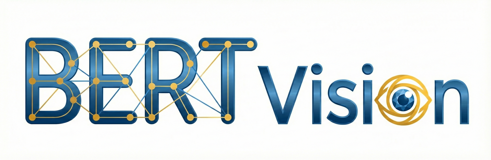
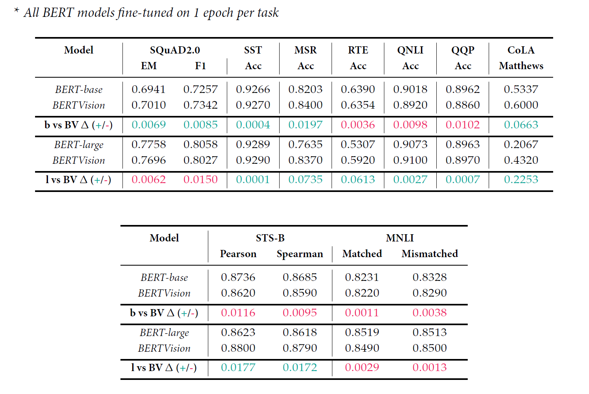
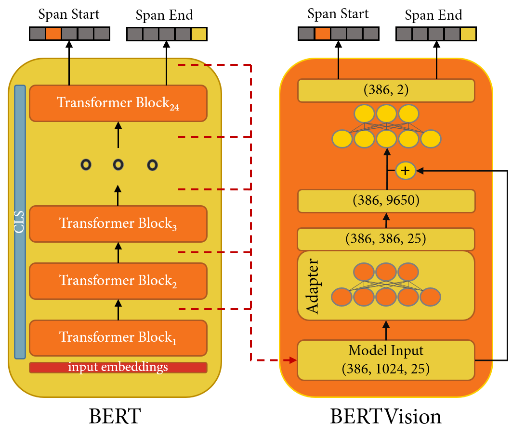

<p align="center">
  
</p>

<p align="center">
  <em>Parameter-efficient fine-tuning using BERT's hidden state activations</em>
</p>

<p align="center">
  <a href="LICENSE.txt"></a>
  
  
  
  
  <a href="https://rajpurkar.github.io/SQuAD-explorer/"></a>
  
  <a href="./paper/"></a>
</p>

---

## Authors

<table align="center" border="0">
  <tr>
    <td align="center">
      <a href="https://jackson.yale.edu/person/casey-king/"></a><br>
      <a href="https://jackson.yale.edu/person/casey-king/">William Casey King, PhD</a>
    </td>
    <td align="center">
      <a href="https://www.linkedin.com/in/siduojiang/"></a><br>
      <a href="https://www.linkedin.com/in/siduojiang/">Siduo (Stone) Jiang</a>
    </td>
    <td align="center">
      <a href="https://cbenge509.github.io/"></a><br>
      <a href="https://cbenge509.github.io/">Cristopher Benge</a>
    </td>
    <td align="center">
      <a href="http://seekinginference.com/"></a><br>
      <a href="http://seekinginference.com/">Andrew Fogarty</a>
    </td>
  </tr>
</table>

<p align="center">
  <br>
  <strong>UC Berkeley</strong> · Masters in Information & Data Science<br>
  Spring 2021 Capstone · W210 with <a href="https://www.ischool.berkeley.edu/people/alberto-todeschini">Alberto Todeschini, PhD</a> & <a href="https://scholar.google.com/citations?user=rT9WRSsAAAAJ">Puya H. Vahabi, PhD</a>
</p>

---

## Key Results

BERTVision achieves BERT-level performance with a fraction of the trainable parameters:

| Model | Params | SQuAD 2.0 EM | SQuAD 2.0 F1 |
|:------|-------:|-------------:|-------------:|
| BERT-large (1 epoch) | 335M (100%) | 72.8 | 77.7 |
| BERT-large (2 epochs, best) | 335M (100%) | 74.7 | 79.2 |
| **BERTVision** (1 epoch) | **~0.4M (0.12%)** | **74.9** | **79.0** |
| Ensemble (BERT + BERTVision) | - | **75.6** | **79.8** |

**Highlights:**
- **~800x fewer trainable parameters** than full BERT fine-tuning
- **Matches BERT 2-epoch performance** with only 1 epoch of embeddings
- **Ensemble surpasses BERT** by +0.9 EM and +0.6 F1
- Works for both **span annotation** (QA) and **binary classification**

<p align="center">
  
</p>

---

## Architecture

<p align="center">
  
</p>

<p align="center">
  <strong>Left:</strong> Standard BERT inference discards hidden layer outputs.<br>
  <strong>Right:</strong> BERTVision captures all 24 layers, feeding them to a lightweight adapter for span prediction.
</p>

---

## Quick Start

### Installation

```bash
# Clone the repository
git clone https://github.com/cbenge509/BERTVision.git
cd BERTVision

# Option 1: Conda (recommended)
conda create -n bertvision python=3.7 pytorch torchvision torchaudio cudatoolkit=10.1 -c pytorch
conda activate bertvision
conda install -c conda-forge jupyter numpy pandas matplotlib scikit-learn transformers datasets tqdm
pip install loguru hyperopt h5py

# Option 2: Pipenv
pipenv install
pipenv shell
```

### Usage

All models run from `code/torch/`:

```bash
cd code/torch

# Fine-tune BERT on SQuAD 2.0
python -m models.bert_squad --model SQuAD --checkpoint bert-large-uncased \
    --lr 2e-5 --max-seq-length 384 --batch-size 8

# Train BERTVision adapter on pre-extracted embeddings
python -m models.ap_squad --model AP_SQuAD --checkpoint bert-large-uncased \
    --lr 2e-5 --max-seq-length 384 --batch-size 8
```

See [`code/torch/README.md`](code/torch/README.md) for full documentation.

---

## Supported Tasks

### SQuAD 2.0
Question answering with span annotation and unanswerable question detection.

### GLUE Benchmark

| Task | Type | Labels | Description |
|:-----|:-----|:------:|:------------|
| CoLA | Classification | 2 | Linguistic acceptability |
| SST-2 | Classification | 2 | Sentiment analysis |
| MRPC | Paraphrase | 2 | Paraphrase detection |
| QQP | Paraphrase | 2 | Question pair similarity |
| STS-B | Regression | 1 | Semantic textual similarity |
| MNLI | NLI | 3 | Natural language inference |
| QNLI | NLI | 2 | Question NLI |
| RTE | NLI | 2 | Textual entailment |
| WNLI | NLI | 2 | Winograd NLI |

---

## Citation

If you use BERTVision in your research, please cite:

```bibtex
@article{jiang2020bertvision,
  title={BERTVision: A Parameter-Efficient Approach for Question Answering},
  author={Jiang, Siduo and Benge, Cristopher and King, William Casey},
  journal={UC Berkeley},
  year={2020},
  url={https://github.com/cbenge509/BERTVision}
}
```

---

## License

This project is licensed under the MIT License - see [LICENSE.txt](LICENSE.txt) for details.
